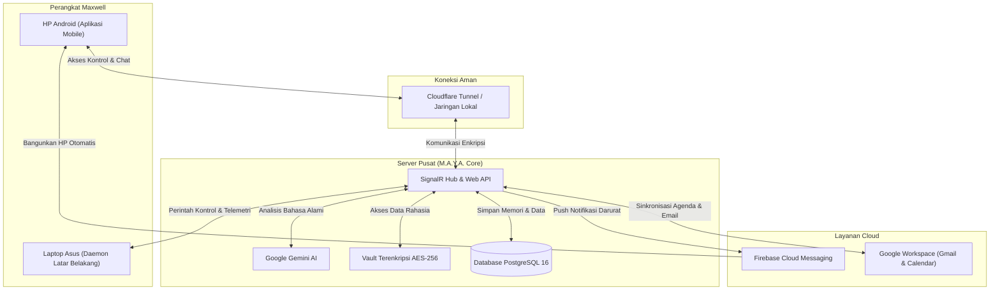
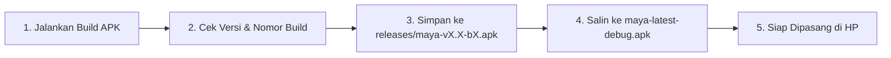
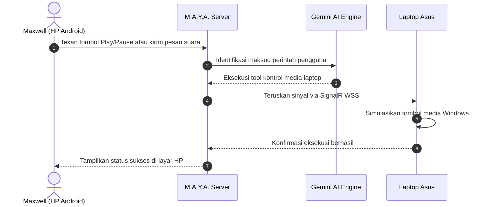
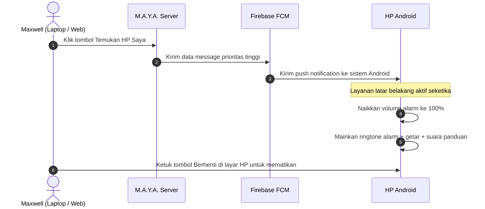
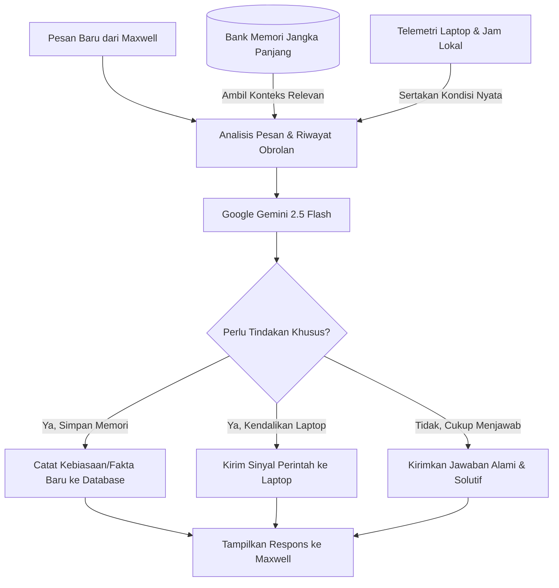
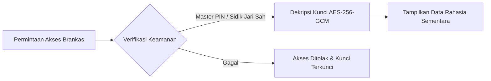
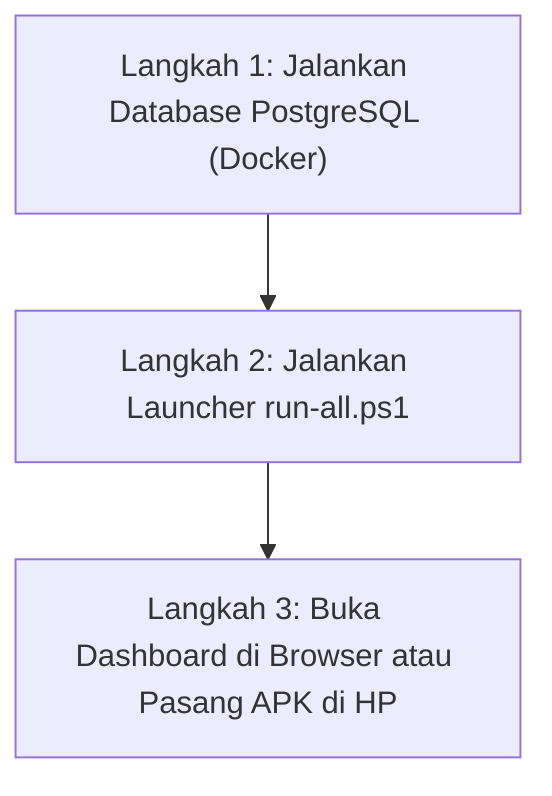

# M.A.Y.A.
### Private AI Assistant and Multi-Device Ecosystem

[](https://dotnet.microsoft.com/)
[](https://react.dev/)
[](https://capacitorjs.com/)
[](https://tailwindcss.com/)
[](https://www.postgresql.org/)
[](https://firebase.google.com/)
[](https://ai.google.dev/)

---

M.A.Y.A. adalah asisten kecerdasan buatan personal yang dibangun untuk mendampingi aktivitas harian Maxwell. Sistem ini menjembatani HP Android dan laptop ke dalam satu ekosistem pribadi yang saling terhubung secara aman, memungkinkan kendali jarak jauh, percakapan cerdas yang mengingat konteks, serta automasi tugas secara langsung.

---

## Alur Kerja Ekosistem M.A.Y.A.

Diagram berikut menggambarkan bagaimana setiap perangkat dan layanan saling bertukar data secara langsung:



---

## Pusat Rilis APK Android (Tanpa Cutover)

Setiap proses build aplikasi Android menghasilkan file APK yang diarsipkan secara rapi di dalam direktori **[`releases/`](releases/)**. Sistem menggunakan penomoran versi berurutan sehingga hasil kompilasi sebelumnya tidak akan tertimpa atau hilang.



### Daftar File Rilis

| File APK | Keterangan | Lokasi File |
| :--- | :--- | :--- |
| **`maya-latest-debug.apk`** | Rujukan build paling baru (disarankan untuk instalasi) | [`releases/maya-latest-debug.apk`](releases/maya-latest-debug.apk) |
| **`maya-v1.0.0-b1-debug.apk`** | Arsip build versi 1.0.0 nomor rilis 1 | [`releases/maya-v1.0.0-b1-debug.apk`](releases/maya-v1.0.0-b1-debug.apk) |

### Cara Membangun APK Versi Baru

Cukup jalankan satu perintah berikut dari terminal:

```powershell
.\scripts\build-apk.ps1
```

*Atau dari folder `maya-client`:*

```powershell
cd maya-client
npm run build:apk
```

Script akan memproses build web, sinkronisasi native Android, kompilasi Gradle, lalu mengarsipkan file dengan nomor build berikutnya secara otomatis.

---

## Skenario dan Kemampuan Utama

### 1. Kendali Laptop Jarak Jauh
Maxwell dapat mengontrol pemutaran musik, volume, dan memantau status perangkat langsung dari layar HP tanpa harus menyentuh laptop.



* **Kontrol Multimedia**: Play, pause, jeda lagu, lagu berikutnya, dan pengaturan tingkat volume suara.
* **Telemetri Perangkat**: Pemantauan beban CPU, penggunaan memori RAM, dan status persentase baterai laptop.
* **Peluncur Aplikasi**: Membuka aplikasi kerja harian seperti VS Code, Spotify, Browser, dan Terminal.

---

### 2. Fitur Temukan HP (Find My Phone)
Saat HP terselip atau lupa meletakkan, laptop dapat mengirimkan sinyal darurat untuk membunyikan alarm di HP secara instan.



* **Tembus Mode Hening**: Volume dinaikkan ke level maksimal secara otomatis.
* **Tetap Aktif Saat Aplikasi Ditutup**: Berkat integrasi Firebase Cloud Messaging, alarm tetap berbunyi walaupun aplikasi HP dalam kondisi mati total.

---

### 3. Otak Cerdas dan Memori Jangka Panjang
Percakapan dengan M.A.Y.A. berlangsung adaptif dan memahami preferensi pribadi Maxwell melalui memori jangka panjang yang terus diperbarui.



* **Memori Adaptif**: Mengingat preferensi kerja, proyek yang sedang dikerjakan, dan catatan penting.
* **Integrasi Google Workspace**: Mampu merangkum email belum dibaca dari Gmail dan mengingatkan jadwal acara di Google Calendar.

---

### 4. Brankas Terenkripsi (Password Vault)
Penyimpanan akun, token, dan catatan rahasia yang dilindungi enkripsi standar industri AES-256-GCM.



---

## Panduan Menjalankan Sistem



### Langkah 1: Siapkan Database Lokal
Jalankan perintah ini di PowerShell untuk menyalakan container PostgreSQL:
```powershell
docker run -d --name maya-postgres -e POSTGRES_DB=maya -e POSTGRES_USER=postgres -e POSTGRES_PASSWORD=postgres -p 5433:5432 --restart unless-stopped postgres:16-alpine
```

### Langkah 2: Jalankan Seluruh Sistem
Gunakan launcher otomatis dari root project:
```powershell
.\run-all.ps1
```

### Langkah 3: Akses Layanan
* Dashboard Web: [http://localhost:5000](http://localhost:5000)
* Dokumentasi API Swagger: [http://localhost:5000/swagger](http://localhost:5000/swagger)
* Status Kesehatan Layanan: [http://localhost:5000/health](http://localhost:5000/health)

---

## Struktur Direktori Repositori

```text
M.A.Y.A/
├── releases/                # Direktori arsip file kompilasi APK Android
├── scripts/                 # Kumpulan script automasi build dan pengujian
├── maya-client/             # Frontend antarmuka pengguna (React 19, Vite, TailwindCSS)
│   ├── android/             # Proyek aplikasi native Android Studio
│   └── src/                 # Komponen antarmuka, SignalR client, audio input/output
├── Maya.Server/             # Layanan backend ASP.NET Core dan SignalR Hub
│   ├── Controllers/         # Endpoint API (Chat, Vault, Memory, Integrasi)
│   ├── Services/            # Logika bisnis Gemini AI, FCM Push, Kriptografi Vault
│   └── Hubs/                # MayaHub untuk pertukaran data real-time
├── Maya.Agent/              # Daemon latar belakang Windows untuk kendali laptop
├── Maya.Shared/             # Model data dan DTO yang dipakai bersama
├── run-all.ps1              # Script launcher satu pintu untuk seluruh layanan
└── PRD.md                   # Dokumen spesifikasi fungsional dan teknis lengkap
```
